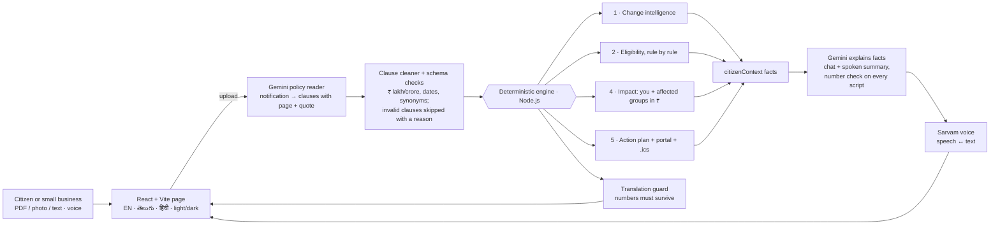

# Haq AI — your rights under every scheme notification, in your language

**Team GenZ GenAI · Forge Gen AI Buildathon · Theme 1, Problem 1**

Government schemes change through notifications: an income limit is raised, an amount is revised, a new document is asked for. Most citizens never learn what changed, whether it now covers them, or what to do before the last date. Haq ("right") reads the official notification, works out what changed and what it means for one citizen in rupees, and gives a dated plan — in English, Telugu or Hindi, by text or voice, with the page of the notification behind every fact.

---

## The five features and where they live

| # | Feature | What the citizen gets | Computed by | Shown in |
|---|---|---|---|---|
| 1 | **Policy Change Intelligence Engine** | Every rule, benefit, date, document and step that was added, withdrawn or revised between two notifications of a scheme — before → now, % change, page in each version | `server/src/engine/changeIntelligence.js` | `ChangeIntelligence.jsx` |
| 2 | **Personalized Eligibility** | Asks only the questions this notification's rules need; verdict with every condition marked met / not met / not known, plus follow-up questions | `server/src/engine/eligibility.js` | `EligibilityCheck.jsx` |
| 3 | **Voice agent** | One-tap **Listen to a summary** of the notification in EN / TE / HI (every number checked against the notification), ask by speaking, answers read aloud, **Listen** on the verdict and the action plan, stop any time | `server/src/engine/spokenExplainer.js`, `server/src/ai/haqGateway.js` (Gemini + Sarvam) | `SpokenSummary.jsx`, `VoiceAssistant.jsx`, `ListenButton.jsx` |
| 4 | **Policy Impact Analyzer** | Your own ₹ per year before, now and the difference; plus the groups the change adds or removes, read straight from the revised rules ("People with family income above ₹2,50,000 and up to ₹3,50,000 — now covered"), each with its page. No invented people. | `server/src/engine/impactAnalyzer.js` | `ChangeIntelligence.jsx` |
| 5 | **Citizen Action Agent** | Ordered plan: confirm missing details, or why you do not qualify, or collect documents → follow steps → submit by the last date → official portal; each with due date, urgency and page; document checklist; calendar file (.ics) | `server/src/engine/actionAgent.js` | `ActionAgent.jsx` |

Also covered from the differentiation table:

- **Evidence with every answer** — each clause carries the PDF page and the exact quote; the page chip opens the uploaded PDF at that page.
- **Legal conditions preserved across translation** — `POST /api/translate` translates clauses into Telugu or Hindi, then `server/src/engine/clauseTranslation.js` checks that every number (₹ amount, age, %, date, also in Telugu/Devanagari digits) is still there. If one is missing or changed, the original wording is shown with a warning. Pages and quotes are always kept.
- **Rights, not just rules** — the notification's own guarantees (grievance time limits, appeals, opt-outs) are extracted into **Your rights**, compared across versions and translated.
- **Citizens and small businesses** — eligibility understands MSME conditions too: enterprise size (micro / small / medium / large), annual turnover and Udyam registration.
- **Robust under bad networks** — every request has a time limit, a dropped connection is retried once, an offline banner appears, and the server status is re-checked until it is back.
- **Conversational explanation** — the assistant answers only from `citizenContext`, which code builds from the notifications: rules, verdict, revisions, impact and the action plan.

## Where Gemini stops and code takes over



The same flow in steps:

```
notification (PDF / photo / text)
   │  Gemini reads it into clauses (POLICY_READER)              ← ai/haqGateway.js
   ▼
clause cleaner  ("₹2.5 lakh" → 250000, "14/09/2026" → 2026-09-14)  ← intake/clauseCleaner.js
   ▼
clause checks   (each rule, benefit, right, date, document, step on its own;
                 a clause that fails is skipped and listed)     ← intake/documentIntake.js, models/policySchemas.js
   ▼
engine (plain code, no AI): changes · eligibility · impact ₹ · action plan · translation number check
   ▼
Gemini explains the computed facts in EN / TE / HI (CITIZEN_HELPER, NOTIFICATION_EXPLAINER), Sarvam speaks them
```

Gemini never decides eligibility, never does arithmetic and never invents a date. If something is not printed in the notification, Haq says so.

## Folders

```
HaqAI/
├── Prompts/                      # Review copies of the four Gemini instructions (a test keeps them identical)
│   ├── policy-reader.txt
│   ├── citizen-helper.txt
│   ├── clause-translator.txt
│   └── notification-explainer.txt
├── server/
│   ├── scripts/model-speed-test.js     # Which Gemini model answers fastest with your key
│   ├── src/
│   │   ├── index.js                    # Starts Haq AI
│   │   ├── haqServer.js                # Web server: CORS, logging without personal data, {message, code} problems
│   │   ├── settings.js                 # Reads server/.env
│   │   ├── problems.js                 # HaqProblem, KeyNotSet, NotAboutSchemes
│   │   ├── routes/haqRoutes.js         # One endpoint per feature
│   │   ├── ai/haqGateway.js            # Only file that calls Gemini and Sarvam
│   │   ├── ai/instructions.js          # POLICY_READER, CITIZEN_HELPER, CLAUSE_TRANSLATOR
│   │   ├── intake/documentIntake.js    # Upload checks → checked SchemeNotification
│   │   ├── intake/clauseCleaner.js     # Indian amounts, dates and wording → engine fields
│   │   ├── models/policySchemas.js     # Shapes of clauses, notifications, citizen details, requests
│   │   └── engine/
│   │       ├── changeIntelligence.js   # Feature 1
│   │       ├── eligibility.js          # Feature 2
│   │       ├── impactAnalyzer.js       # Feature 4
│   │       ├── actionAgent.js          # Feature 5
│   │       ├── clauseTranslation.js    # Number-checked translation
│   │       ├── spokenExplainer.js      # One-tap spoken summary, numbers checked
│   │       ├── officialPortal.js       # Where to apply (printed link → checked list → myScheme search)
│   │       ├── citizenContext.js       # Facts the assistant may use
│   │       ├── ruleText.js, rupees.js  # Readable rules, ₹ with lakh grouping
│   └── tests/                          # engine, intake, gateway, routes (synthetic fixture only)
└── client/
    ├── src/App.jsx
    ├── src/components/   NotificationIntake · NotificationShelf · SchemeSnapshot · ClauseTranslation
    │                     ChangeIntelligence · EligibilityCheck · ActionAgent · ApplyPortal · VoiceAssistant · SpokenSummary · ListenButton · Shell · Icon
    ├── src/lib/          haqApi.js (server calls) · schemeMath.js (₹, dates, .ics) · i18n.js (EN/TE/HI) · hooks.js
    └── tests/schemeMath.test.js
```

## Getting Haq running on your laptop

Needs Node 20 or newer.

**Keys** — in `server/`, copy `.env.example` to `.env` and fill in:

| Variable | Needed for | Default |
|---|---|---|
| `AI_API_KEY` | Reading notifications, answers, translation (Gemini, from aistudio.google.com/apikey) | — |
| `AI_MODEL` | Gemini model | `gemini-3.5-flash-lite` (`gemini-3.8-flash` reads long, table-heavy notifications better) |
| `SARVAM_API_KEY` | Voice in and out (dashboard.sarvam.ai) | voice off |
| `SARVAM_STT_MODEL` / `SARVAM_TTS_MODEL` / `SARVAM_SPEAKER` | Voice models | `saaras:v4` / `bulbul:v3` / `priya` (retired names are upgraded automatically) |
| `CLIENT_ORIGIN` | Page allowed to call the server | `http://localhost:5173` (any localhost port works) |
| `PORT` | Server port | `8000` |

`client/.env` (optional): `SERVER_URL=http://localhost:8000`, `CLIENT_PORT=5173`.
Keys stay in `server/.env`, which git ignores; the page never sees them.

**Start** (two terminals):

```bash
cd server && npm install && npm start      # "Haq AI is running on http://localhost:8000"
cd client && npm install && npm run dev    # open http://localhost:5173
```

The chip in the top bar says **Ready to read notifications** when the Gemini key works, **Gemini key needed** when it is missing, and **Haq server not running** when the page cannot reach the server.

**Model speed** — `cd server && node scripts/model-speed-test.js`.

## A demo run with real notifications

Haq ships with **no scheme data**; everything comes from what you upload (the buildathon does not allow dummy data).

1. Download two notifications of the same scheme from scholarships.gov.in, myscheme.gov.in, egazette.gov.in, pib.gov.in or a state portal — ideally an older and a newer one where a limit or amount changed.
2. Drop the first one on the upload card, press **Read**, then add the second.
3. **What changed** lists the revisions; **Who gains and who loses** shows the rupee effect.
4. Answer **Do I qualify?** → verdict → **Listen**.
5. **Your action plan** → **Add dates to my calendar**.
6. Switch to తెలుగు or हिंदी → **Read clauses in …** → ask by voice.

## Endpoints

All errors come back as `{ "message": "...", "code": "..." }`.

| Method | Path | Body → reply |
|---|---|---|
| GET | `/api/health` | → `{status, reading_ready, voice_ready}` |
| POST | `/api/notifications/read` | multipart `file` and/or `text` → `{notification, skipped_clauses, clause_count}` |
| POST | `/api/changes` | `{older, newer}` → `{revisions, tally, same_scheme, swapped, older_label, newer_label}` |
| POST | `/api/eligibility` | `{notification, citizen}` → `{verdict, conditions, missing_fields, follow_up_questions}` |
| POST | `/api/impact` | `{older, newer, citizen?}` → `{profiles[{label, transition, benefit_before, benefit_after, yearly_gain, what_it_means, reasons}], summary}` |
| POST | `/api/action-plan` | `{notification, citizen}` → `{verdict, headline, actions[{kind, title, detail, due, urgency, page}], checklist, days_left}` |
| POST | `/api/ask` | `{question, history, notifications, citizen, language}` → `{reply}` |
| POST | `/api/translate` | `{notification, language: te/hi}` → `{clauses[{original, translated, kept_original, page, quote}], kept_original}` |
| POST | `/api/explain` | `{notification, older?, citizen, language}` → `{script, language, checked, fallback}` (numbers in the script verified against the notification) |
| POST | `/api/voice/listen` | multipart `audio`, `language` → `{text}` |
| POST | `/api/voice/speak` | `{text, language}` → `{audio_base64, mime_type}` |

Codes you may see: `invalid_request`, `same_notification`, `not_about_schemes` (422), `key_not_set` (503), `service_failed` (502), `too_large` (413), `slow_down` (429).

## Tests

```bash
cd server && npm test    # 59 tests: five features, affected groups, MSME fields, rights, spoken-summary number check, clause cleaner, translation check, gateway (fetch stubbed), endpoints
cd client && npm test    # ₹ formatting, version pairing, calendar file
```

The tests use a synthetic `TEST-SCHOLARSHIP` fixture that exists only in `server/tests/fixtures.js`; the running app never loads it.

## Privacy and limits

- Nothing is stored: files are read in memory for one request; notifications and answers stay in the browser tab.
- The server log has route, status and time only.
- Haq AI is informational. It is not a government website; the department and its portal have the final word.
- Rules that cannot be expressed as a check (for example "domicile for 10 years") are listed under **Things the notification did not make clear** rather than checked.
- No sample or mock data ships with the app: every result comes from a notification the user uploads and the details they enter. The only fixture (`TEST-SCHOLARSHIP`) lives in `server/tests` and is never loaded by the running app.

## When something is off

| You see | Do this |
|---|---|
| **Gemini key needed** | Put `AI_API_KEY` in `server/.env`, restart the server. |
| **Haq server not running** | Start the server; check `SERVER_URL` in `client/.env` matches `PORT`. |
| Microphone button greyed out | Add `SARVAM_API_KEY` and restart. |
| "Gemini could not find the model" | Fix `AI_MODEL`; run the model speed test. |
| "too long to read at once" | Upload only the eligibility, benefit and how-to-apply pages. |
| A translated clause shows the English text | Expected: a number did not survive translation, so the original is kept. |
